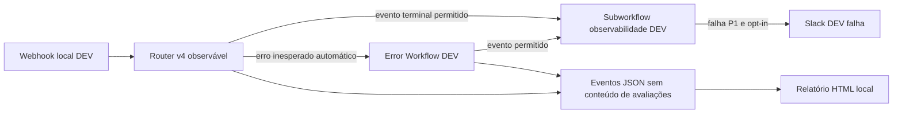

# Etapa 2 — Router DEV observável

## Estado e alcance

Atualização documental em **23/11/2026**: a coleta real no n8n DEV foi concluída
com **11 execuções controladas** e o dashboard local está disponível. O responsável
informou o alerta **P1 de falha terminal implementado e validado no Slack DEV**.
Os resultados, thresholds iniciais e limites de interpretação estão
[registrados abaixo](#thresholds-iniciais-dev-e-resultados-observados).

A implementação inicial foi verificada offline; a coleta posterior usa o engine
n8n local **2.28.7**, com amostra sintética e limitada. Essa coleta não comprova
desempenho em produção, cobertura de crash/watchdog ou todos os comportamentos
do Error Trigger. O roteiro de revalidação permanece abaixo. Esta atualização
altera somente documentação, sem novas chamadas a APIs, ativação ou deploy.

Os exports da candidata permanecem **inativos**, sem credenciais, dados fixados
ou IDs locais de workflow. V3, v4 original, v4 otimizada anterior e retenção foram preservados.
Os riscos/registros históricos da [retenção](etapa-2-observabilidade.md) continuam
válidos; sua aprovação anterior não é evidência de aprovação do Router integrado.

## Componentes separados

O benefício da deduplicação foi medido no
[benchmark real DEV concluído](benchmark-real-deduplicacao-dev.md): duas cópias
isoladas com resposta terminal, sem modificar este Router ou habilitar logs
globais. [Relatório público sanitizado](evidencias/benchmark-dev-real.html):
LLM 15 → 5, custo US$ 0,000675 → 0,000225 e média 2396,87 → 1549,93 ms; GETs
Airtable 15 → 20. Acurácia persistida não avaliada nesse par. Não misturar com
os cinco rótulos da coleta de 11 runs abaixo.



| Export | Papel |
| --- | --- |
| `vozdocliente-router-v4-observavel-dev.json` | Classificação, controles existentes, eventos por etapa, saídas de erro seguras |
| `vozdocliente-observabilidade-router-dev.json` | Execute Workflow Trigger, allowlist de evento, decisão e entrega do alerta |
| `vozdocliente-erros-router-dev.json` | Error Trigger, normalização mínima, entrega ao mesmo observador |

O gerador `scripts/build_router_observability.py` deriva do gerador da v4
otimizada. Reutiliza **diretamente** do gerador da retenção os parâmetros de
`Slack DEV falha`, `Alertar falha DEV?` e o código de `Resultado observabilidade`.
O transporte continua HTTP Request **4.1**, `sendBody: true` literal, JSON,
endpoint Slack fixo, sem redirect/retry, timeout de 5 s, confirmação HTTP 2xx **e**
`body.ok=true`. Não há cópia de token nem ligação à instância da porta 5680.
As credenciais dessa instância não aparecem automaticamente na porta 5678.

O contrato `n8n-mirror/observability/router-contract.json` define campos, etapas e
códigos permitidos. O JavaScript compartilhado é compilado nos Code nodes;
o relatório Python lê o mesmo contrato. Não há serviço de telemetria externo,
dependência de CDN, novo banco ou alteração no schema Airtable.

## Instrumentação e interrupções

`Recebimento observado DEV` gera `run_id=router-<execution.id>`, substituindo
qualquer `_obs` do cliente. Ele é correlacionável à execução **desta instância**,
não é um identificador de cliente nem global entre instâncias. As etapas são
`received`, `sanitization`, `precheck`, `llm`, `final_dedup`, `persistence` e
`business_slack`. Há eventos de início/conclusão e um terminal de tipo `run`:
`success`, `duplicate` ou `failure`.

`Sanitizar PII`, `Preparar deduplicacao DEV`, precheck, parser, consulta final e
bodies HTTP preservam seus parâmetros/código funcionais. LLM só recebe
`review_text_sanitized`; o texto original não é restaurado para classificá-lo.
O Airtable continua recebendo os campos originais para tratativa, como na v4.
Não há garantia de anonimização por regex.

Os dez nodes operacionais usam **`onError=continueErrorOutput`**, nunca
continuação pela saída normal. A segunda saída vai exclusivamente para
`Falha segura: <nome do node>`, que ignora o erro bruto, emite código fixo e
converge ao observador. `Falhou Router DEV?` envia falhas para
`Interromper com seguranca` (Stop And Error), com mensagem fixa. Falhar no
observador/Slack não libera LLM, criação ou reprocessamento.

Exemplos de códigos: `SANITIZATION_FAILED`, `DEV_CONFIG_INVALID`,
`PRECHECK_HTTP_FAILED`, `PRECHECK_INVALID`, `LLM_HTTP_FAILED`,
`CLASSIFICATION_INVALID`, `FINAL_DEDUP_HTTP_FAILED`, `PERSISTENCE_HTTP_FAILED`.
Não copiamos mensagem, URL do erro, stack, headers, corpo HTTP, review ID, texto,
nome, classificação individual ou canal aos eventos. O alerta contém apenas
run ID técnico, etapa, código, duração e número de tentativas.

### Error Workflow / Error Trigger

O mecanismo nativo dispara o Error Workflow associado quando uma execução
**automática** falha. **Executar manualmente/Test Webhook não dispara esse Error
Trigger**. Por isso HTTP precheck e os outros nodes operacionais têm captura
explícita de erro no próprio grafo, válida também no teste manual. Não usamos
Error Trigger como única proteção.

Na UI, selecionar `VozDoCliente - Erros Router DEV` em **Settings → Error
Workflow** da candidata. Essa associação exige um ID local e não está no export.
Error Workflow/subworkflow não precisam ser publicados para serem chamados;
conferir também a permissão de chamada entre workflows do mesmo projeto/owner.
Não configurar Error Workflow no observador nem nele próprio: evita recursão.

O normalizador aceita somente o ID explícito `ROUTER_OBSERVED_WORKFLOW_ID` e
`CLASSIFIER_ENV=DEV`. Usa `execution.id` original se disponível. Esse ID/URL pode
não estar disponível conforme persistência e fase da falha. Sem ID original,
usa `router-error-<ID da execução do handler>`, `correlation=error_handler`:
isso identifica **o incidente no handler**, não permite vincular com segurança
à avaliação/execução original. Contagens e duração desconhecidas ficam `null`.
Não habilitar armazenamento de payloads para tentar obter esse ID.

Uma parada cujo `lastNodeExecuted` seja `Interromper com seguranca` é ignorada
pelo Error Workflow, pois já teve evento terminal e tentativa de alerta. Não há
deduplicação durável de Slack: retries manuais ou um payload nativo diferente do
esperado podem repetir alertas. O relatório deduplica eventos/runs conhecidos,
mas não corrige entrega Slack duplicada.

Erros de preparação antes do primeiro node, perda do processo, crash, ausência
de logs, indisponibilidade do handler e certas interrupções/timeouts ainda podem
escapar. Erros inesperados dos próprios nodes de instrumentação em execução
manual não acionam Error Trigger. Não há watchdog ou garantia exactly-once.

Referências para conferência pelo responsável, **não consultadas por rede nesta
implementação**: [tratamento de erros n8n](https://docs.n8n.io/flow-logic/error-handling/)
e [Error Trigger](https://docs.n8n.io/integrations/builtin/core-nodes/n8n-nodes-base.errortrigger/).
O formato efetivo e essas integrações exigem a validação local descrita abaixo;
testes de VM não substituem teste do engine 2.28.7.

## Métricas e interpretação

Cada evento contém `schema`, `event_id`, `run_id`, `correlation`, `at`, `source`,
`kind`, `stage`, `status`, `duration_ms`, `error_code` e `metrics`. Contadores de
runs valem 1 somente no terminal. Inícios/conclusões não multiplicam volume.

| Medida | Definição e limite |
| --- | --- |
| Volume | Runs distintos observados/terminais, recebimentos conhecidos, incompletos e incidentes correlacionados só ao handler separados. Não inferir tráfego dos incidentes sem ID original. |
| Sucesso/duplicata/falha | Estados terminais separados; taxa de erro = falhas / terminais na janela fornecida. Incompletos não entram nesse denominador e aparecem separadamente. Não é disponibilidade/SLO. |
| Latência p50/p95/p99 | Nearest-rank: posição `ceil(p*N)`. Só durações conhecidas. Total do processamento até o evento terminal, inclui instrumentação e Slack CX quando executado; exclui entrega do alerta/observador posterior. Etapas concluídas têm percentis próprios. Não é latência HTTP do webhook, que responde no início. |
| LLM | `llm_calls_attempted` marca entrada na chamada, sem retry; não comprova transporte aceito ou faturamento. `llm_responses` conta respostas recebidas, inclusive JSON inválido. Falha antes de enviar ainda pode contar uma tentativa. |
| Persistência | Escritas confirmadas. Timeout pode ocorrer depois da criação no Airtable; zero confirmações não prova ausência de gravação. A corrida após a deduplicação final continua existindo. |
| Custo estimado LLM | `(prompt_tokens*preco_entrada + completion_tokens*preco_saida)/1e6`. Tokens vêm de `usage`, sem conteúdo. Sem uso/preço válido fica `null`; sem tentativa é zero. Relatório mostra subtotal conhecido e cobertura, nunca converte desconhecido em fatura zero. Exclui cache/descontos, Airtable, Slack e infraestrutura. |
| Qualidade técnica | `classification_valid / llm_responses` conhecidas (`schema_valid_rate`): aderência aos enums/JSON após parser. Permanece independente da acurácia de sentimento/tema. |
| Qualidade semântica manual (opcional) | `--labels` correlaciona avaliações manuais exclusivamente a runs de sucesso da fonte `n8n`. Acurácias de sentimento, tema e conjunta usam somente as avaliações rotuladas; conjunta exige ambos os acertos no mesmo run. `classification_accuracy` representa a conjunta; `human_labels` conta os runs avaliados. Sem arquivo, os campos históricos continuam `null` e `0`. |

Preços em USD/milhão não têm default e devem ser confirmados para o modelo/projeto,
com data/fonte registradas pelo responsável. Não houve consulta de preço/modelo.
O modelo/prompt/schema foram preservados; a equivalência sintética de 120 entradas
compara todos os registros com a candidata anterior. Não mede qualidade humana.
As medições DEV abaixo incluem a instrumentação até o terminal, mas não isolam
seu custo incremental nem o do subworkflow posterior. O ganho antes/depois
da deduplicação foi medido no benchmark separado, não nesta comparação de instrumentação.

## Thresholds iniciais DEV e resultados observados

O [dashboard público](evidencias/router-observabilidade-dev-real.html) preserva
a coleta de 11 execuções e sua avaliação de qualidade. O benchmark concluído é
outra janela: 15/15 envios reconciliados por versão, sem falhas nesse lote;
depois p50=695 ms, p95/p99=3437 ms e custo médio conhecido US$ 0,000045 (5/5).
Esses valores ficam nos limites DEV de latência/custo, volume e validade.
Não reclassificam os 27,27% de falhas intencionais como erro normal nem demonstram
acurácia ≥90%: o benchmark não avaliou semântica e a amostra separada continua 80%.

Estes limites são critérios iniciais de revisão pelo responsável técnico no
ambiente **DEV**, definidos para a arquitetura atual. Os valores de referência
são inclusivos: até o limite para latência, custo e erro; pelo menos o limite
para acurácia; exatamente 100% para reconciliação e validade estrutural.
São metas de triagem e evolução da Etapa 2, sem SLA/SLO de produção ou garantia
estatística. O dashboard fornece as métricas; a comparação com os thresholds
e a decisão P3 são **manuais**, sem notificação automática implementada.

### Resultados da coleta real controlada

Fonte: eventos sanitizados locais `router-local-final-permitido.ndjson`, relatório
`scripts/router_observability_report.py` e
[cinco avaliações manuais](evidencias/router-qualidade-dev-rotulos.json). Os arquivos
de coleta/dashboard `router-local*` permanecem locais e ignorados pelo Git;
o [agregado público](evidencias/router-observabilidade-dev-real.json) e seu
[HTML](evidencias/router-observabilidade-dev-real.html) não contêm eventos individuais.
Não somar esses resultados aos da simulação offline de 3 execuções descrita adiante.

| Indicador | Resultado observado e cobertura |
| --- | --- |
| Execuções terminais | **11**: **7 sucessos**, **1 duplicata** e **3 falhas intencionais** de teste. |
| Latência p50 | **3742 ms** (3,742 s). |
| Latência p95 | **6730 ms** (6,730 s). |
| Latência p99 | **6730 ms** (6,730 s). |
| Cobertura de latência | **10 das 11** execuções têm duração conhecida; a duração desconhecida não entra nos percentis. |
| Custo médio estimado por classificação com custo conhecido | **US$ 0,0000434**, calculado como **US$ 0,000217 / 5 classificações**. Das 7 classificações concluídas, **5 têm custo conhecido e 2 têm custo desconhecido**. |
| Taxa de falha do experimento | **3/11 = 27,27%**, incluindo as **3 falhas intencionais**. Não representa erro em operação normal. |
| Volume observado | **11 execuções terminais distintas** na coleta. A cobertura sobre envios exige também o registro dos envios do lote; contar terminais isoladamente não comprova reconciliação de 100%. |
| Validade estrutural | **100% (7/7 respostas conhecidas)**, métrica independente da acurácia semântica. |
| Acurácia de sentimento | **80% (4/5)** nas avaliações rotuladas. |
| Acurácia de tema | **100% (5/5)** nas avaliações rotuladas. |
| Acurácia conjunta | **80% (4/5)**, abaixo do threshold de 90%. |

Os percentis usam nearest-rank. Com apenas **10 durações**, p95 e p99 selecionam
o mesmo máximo observado; sua igualdade não comprova estabilidade da cauda.
O caminho medido percorre sanitização, precheck no Airtable, LLM quando necessário,
deduplicação final, persistência e Slack CX quando aplicável, até o terminal.
Não mede a resposta inicial do webhook nem a entrega posterior do alerta P1.
O lote mistura sucessos, duplicata e falhas induzidas: seus percentis descrevem
esse experimento, não uma distribuição homogênea de classificações em operação normal.

A média de custo usa somente as **cinco classificações com estimativa conhecida**.
Os **8 runs com custo conhecido** no agregado geral incluem outros **3 runs sem
tentativa LLM, com zero conhecido**; dividir o subtotal por 8 ou por 11 diluiria
indevidamente o custo por classificação. Custos desconhecidos permanecem `null`,
não viram zero. A estimativa parcial de LLM não é fatura e exclui Airtable,
Slack e infraestrutura; não permite inferir o custo das duas classificações sem
estimativa. Não houve nova consulta de preços nesta atualização.

As falhas intencionais devem permanecer identificadas nos registros dos testes.
Para avaliar erro normal, usar uma janela/lote de operação normal separado,
com denominador e cenários declarados, contando todas as falhas não induzidas.
Nessa janela, a taxa é `falhas não induzidas / execuções terminais × 100`;
duplicatas encerradas normalmente continuam no denominador e incompletos devem
ser investigados pela reconciliação de volume.
Não comparar **27,27%** diretamente com a meta de **5%**, nem concluir uma taxa
normal de 0% apenas removendo as falhas intencionais deste experimento. A amostra
sintética limitada e a ausência de uma janela representativa impedem essa conclusão.

### Limites e justificativas individuais

| Indicador | Threshold inicial DEV | Justificativa e leitura da medição |
| --- | --- | --- |
| Latência p50 | **Até 8 s (8000 ms)** | O processamento sequencial combina consultas Airtable, inferência LLM e persistência. O p50 de 3,742 s fica abaixo de 8 s; a margem permite variação de rede/fornecedores e instrumentação, e sinaliza degradação do caminho típico. É uma escolha operacional inicial, sem comprovar esse percentil em carga representativa. |
| Latência p95 | **Até 12 s (12000 ms)** | O limite acomoda variação nas várias chamadas remotas e o ramo de Slack CX, mantendo um critério para investigar execuções mais lentas. Os 6,730 s observados ficam abaixo do limite, mas N=10 não caracteriza a cauda de 95% em operação normal. |
| Latência p99 | **Até 15 s (15000 ms)** | A margem adicional ao p95 dá um limite de revisão para atrasos raros acumulados no fluxo sequencial. Os 6,730 s observados ficam abaixo de 15 s; com N=10, esse valor é apenas o máximo da amostra e não demonstra um p99 operacional nem substitui os timeouts de cada node. |
| Custo médio estimado por classificação com custo conhecido | **Até US$ 0,0001** | A classificação usa LLM, com custo variável conforme tokens e preço configurado; a deduplicação anterior evita chamadas repetidas, mas não reduz por si só o custo unitário de uma classificação executada. A média conhecida de US$ 0,0000434 fica abaixo do limite, que admite cerca de 2,3 vezes essa referência para variação de tokens, mas exige investigar aumento de uso/configuração/preço. A cobertura de 5/7 deve acompanhar a média; o limite não limita o custo total nem valida custos desconhecidos. |
| Taxa de erro em operação normal | **Até 5%** | O Router deve concluir a classificação ou encerrar duplicatas normalmente; seus bloqueios seguros tornam falhas explícitas, sem liberar LLM/persistência indevidos. O teto inicial serve para investigar falhas não induzidas de configuração, integração ou fornecedores. A medição de 27,27% exercitou esses bloqueios deliberadamente e não avalia o cumprimento desta meta. |
| Volume reconciliado | **100% dos eventos enviados no lote controlado vinculados a execuções terminais** | Como a coleta é local e não há coletor durável/watchdog, a contagem de logs pode ocultar perdas. Comparar o registro de envios com runs terminais distintos detecta ausências e incompletos. Os 11 terminais observados são o numerador disponível; a conformidade exige conferir o total e o vínculo de cada envio, não presumir 100% pela existência do dashboard. |
| Acurácia conjunta de sentimento e tema | **Pelo menos 90%** | O roteamento CX depende do sentimento e a classificação útil exige também o tema correto. A meta exige ambos corretos no mesmo run e permanece acima dos **80% observados**, portanto **não atendida na amostra rotulada**. A divergência de sentimento em `router-78` exige revisão; tema 100% não compensa esse erro. Com N=5, cada caso vale 20 pontos percentuais e atingir 90% exige 5/5; ampliar uma amostra equilibrada antes de generalizar. |
| Validade estrutural das respostas | **100%** | O parser e os enums são o contrato necessário para persistência e roteamento seguros. Saídas inválidas devem ser bloqueadas e investigadas, sem flexibilizar o contrato. Os **7/7** observados atendem à meta nessa coleta; isso mede formato/valores permitidos, não garante sentimento ou tema corretos. |

Na reconciliação de volume, calcular `terminais distintos vinculados aos envios /
total de envios do lote × 100`, após encerrar a coleta e conferir o destino de
cada envio. Contar `success`, `duplicate` e `failure` como terminais; um reenvio
do mesmo conteúdo é outro envio e precisa de sua própria execução, mesmo que
termine como duplicata. Eventos internos de etapas ou linhas recoletadas não
são novos envios; incidentes apenas do handler não provam o vínculo original.
Sem registro de envios, marcar a reconciliação como **não aferida**, nunca como
aprovada. O registro deve conter somente identificadores técnicos e contagens,
sem payloads, textos originais, nomes ou PII.

O responsável técnico deve revisar os thresholds ao mudar modelo, prompt,
arquitetura, preços ou perfil de carga e ao ampliar a amostra. Registrar janela,
versão e denominadores, separando teste de falha, lote normal DEV e eventual
medição de produção. Resultados DEV e simulações não substituem essa última.

## Slack operacional e configuração

As prioridades abaixo são operacionais do **DEV**, sem SLA de produção. Todos
têm como público o **responsável técnico**. A entrega do P1 no Slack DEV já foi
implementada e validada, conforme informado pelo responsável. **P2 e P3 são
procedimentos de diagnóstico/revisão, sem notificações automáticas implementadas.**

| Prioridade | Gatilho | Público | Canal e estado | Ação esperada |
| --- | --- | --- | --- | --- |
| **P1** | Falha terminal do Router | Responsável técnico | **Slack DEV**, alerta automático opt-in **já implementado e validado** | Correlacionar run ID, etapa e código fixo; identificar se a falha era intencional; investigar configuração/integração e conter o impacto. Antes de reprocessar manualmente, conferir persistência e deduplicação para evitar efeitos repetidos. |
| **P2** | Falha de entrega da observabilidade | Responsável técnico | **Diagnóstico local** na saída/logs permitidos, sem notificação automática ou alerta recursivo | Conferir `OBS_DELIVERY_FAILED`, `not_configured`/`delivery_failed` e o estado de entrega Slack; revisar pareamento de workflows, opt-in, permissões e transporte DEV sem expor credenciais. Corrigir a entrega e revalidar a correlação, sem reiniciar automaticamente o processamento de negócio. |
| **P3** | Desvio dos thresholds documentados | Responsável técnico | **Revisão manual do dashboard**, sem notificação automática | Conferir janela, denominador, cobertura e presença de falhas induzidas; recalcular a média apenas sobre classificações com custo conhecido e reconciliar os envios do lote. Investigar latência/custo/qualidade; revisar `router-78` pela conjunta de 80%, registrar a ação e repetir avaliação controlada após correção. |

Sucesso/duplicata não geram P1. Falhas intencionais continuam exercitando esse
alerta e devem ser identificadas como teste na análise. Falta de cobertura ou
denominador impede aprovar um threshold e requer revisão manual. Alertas CX por
sentimento negativo continuam no node separado `Slack DEV`; não são falhas
terminais nem notificações P3.

Em `n8n-mirror/.env`, usado explicitamente nos comandos abaixo:

```dotenv
CLASSIFIER_ENV=DEV
# Manter IDs DEV da base/tabela/canal ja validados, nunca PROD.
ROUTER_OBSERVER_WORKFLOW_ID=<ID local de VozDoCliente - Observabilidade Router DEV>
ROUTER_OBSERVED_WORKFLOW_ID=<ID local da nova candidata Router>
ROUTER_ALERTS_ENABLED=false
ROUTER_OBS_STDOUT_ENABLED=false
OBS_LLM_INPUT_USD_PER_MILLION=
OBS_LLM_OUTPUT_USD_PER_MILLION=
```

IDs não são credenciais, mas exigem conferência manual do destino: não apontar
o observador para qualquer outro workflow, especialmente Router/handler ou PROD.
Definir `ROUTER_ALERTS_ENABLED=true` somente para receber alerta **real** no canal
`CLASSIFIER_SLACK_DEV_CHANNEL_ID` já validado. Selecionar Header Auth Slack DEV
no node **`Slack DEV falha` do subworkflow**. Verificar bot/canal/workspace e
escopo `chat:write`, sem abrir tokens em evidências. A credencial de `Slack DEV`
na candidata é independente desta seleção.

`CODE_ENABLE_STDOUT` é global e só é habilitado quando
`ROUTER_OBS_STDOUT_ENABLED=true`. Revisar os demais workflows locais antes disso:
eles podem imprimir PII. Manual envia console ao navegador; chamadas/subworkflows
não manuais podem enviar ao stdout. O Compose prevê rotação por tamanho (5 MiB,
3 arquivos), **não por idade**. Nenhum contêiner foi recriado nesta entrega.

Após importar e anotar IDs, aplicar somente à instância local (raiz do projeto;
reutilizar o mesmo `-p` se a instância tiver projeto customizado):

```powershell
docker compose --env-file n8n-mirror/.env -f n8n-mirror/docker-compose.yml config --quiet
docker compose --env-file n8n-mirror/.env -f n8n-mirror/docker-compose.yml up -d --no-deps --force-recreate --pull never n8n
```

O observador ausente/inacessível produz `not_configured`/`delivery_failed` e evento
`OBS_DELIVERY_FAILED`; não apaga o terminal nem modifica classificação/dedup.
Entrega Slack distingue `not_needed`, `disabled`, `blocked`, `sent`, `failed`.
Timeout pode ocorrer após entrega; não há retry automático.

## Relatório local e evidência reproduzível

Sem n8n/credenciais/APIs, na raiz:

```powershell
python scripts/build_router_observability.py --check
node tests/test_router_observability.cjs
node scripts/simular_router_observabilidade.cjs --output docs/evidencias/router-observabilidade-simulacao.ndjson --metadata-output docs/evidencias/router-observabilidade-simulacao.json
python scripts/router_observability_report.py --input docs/evidencias/router-observabilidade-simulacao.ndjson --output docs/evidencias/router-observabilidade-simulacao.html
```

Abrir [relatório visual](evidencias/router-observabilidade-simulacao.html).
[Eventos](evidencias/router-observabilidade-simulacao.ndjson) e
[manifesto com hashes](evidencias/router-observabilidade-simulacao.json) registram
**3 execuções simuladas: 1 sucesso, 1 duplicata, 1 falha de precheck; 1 chamada LLM
simulada e 1 alerta simulado; zero chamadas externas**. Tokens da resposta são
fixtures sintéticas. Tempos vêm de `Date.now()` no harness local, com mocks
imediatos, sem atraso artificial; não são latências de n8n/Airtable/OpenAI.
Percentis variam ao reproduzir. A amostra pequena não demonstra p99 operacional.
Na evidência anexada: **23 eventos**, taxa de falha do cenário **1/3**, p50
**5 ms**, p95 **31 ms** e p99 **31 ms**, com N=3 no harness local. Esses números
descrevem apenas a simulação coletada, não a instância n8n nem os fornecedores.
Preço não configurado deixa o custo da classificação desconhecido; validade
técnica da única resposta sintética não demonstra acurácia real.

Para eventos **realmente coletados** no n8n, copiar só as linhas JSON com `schema`
do console (ou stdout, após opt-in) para um arquivo local `router-local.ndjson`.
Não exportar a execução inteira. Gerar relatório em destino local fora do Git:

```powershell
python scripts/router_observability_report.py --input router-local.ndjson --output router-local.html --events-output router-local-permitido.ndjson
```

O leitor aceita JSONL e prefixo de stdout/Docker; rejeita campos extras, códigos,
tipos e números inválidos. Não retransmite nem grava linhas rejeitadas. O HTML
não contém scripts remotos/credenciais. `source=n8n` e `offline_simulation` são
agregados em painéis separados; origem é uma marca de coleta, não assinatura de
autenticidade. Não misturar logs de várias instâncias com IDs possivelmente iguais.
Falhas prevalecem em terminais conflitantes do mesmo run; evento inline é
preferido ao fallback do handler. Isso não reconstrói dados perdidos.

### Qualidade manual da coleta DEV — amostra sintética e limitada

A coleta local real do n8n DEV contém **11 execuções terminais: 7 sucessos,
1 duplicata e 3 falhas**. Cinco sucessos foram avaliados manualmente. Os dados
de entrada dessa avaliação são **sintéticos e limitados**: executar no engine
real não torna essa amostra representativa de clientes ou de produção.
O arquivo [rótulos da amostra DEV](evidencias/router-qualidade-dev-rotulos.json)
registra somente IDs técnicos, enums esperados e obtidos, sem textos originais,
nomes ou PII. Os resultados obtidos foram transcritos manualmente: a telemetria
comprova o sucesso do run, mas não contém a classificação para verificá-los.

| Métrica | Resultado na amostra rotulada |
| --- | --- |
| Acurácia de sentimento | 4/5 = **80%** |
| Acurácia de tema | 5/5 = **100%** |
| Acurácia conjunta | 4/5 = **80%** |
| Total de avaliações rotuladas | **5** |

A divergência está em `router-78`: sentimento esperado `neutro`, obtido
`positivo`, com tema `preco` correto. O denominador das acurácias é **5**,
não o total de 11 execuções nem os 7 sucessos. Validade estrutural continua
com seu denominador original de respostas conhecidas.

Na raiz, usando a coleta sanitizada local existente (não versionada):

```powershell
python scripts/router_observability_report.py --input router-local-final-permitido.ndjson --labels docs/evidencias/router-qualidade-dev-rotulos.json --output router-local-qualidade.html
```

O comando anterior sem `--labels` continua funcionando e preserva o HTML
anterior. O novo HTML inclui percentuais, acertos/total e a limitação da amostra.
As fontes `n8n` e `offline_simulation` continuam em painéis separados; os
rótulos acima nunca são aplicados ao painel de simulação offline, mesmo que
um `run_id` coincida.

Contrato do JSON de rótulos:

- Envelope exato: `schema=vozdocliente.router.quality-labels.v1`, `source=n8n`,
  `sample=synthetic_limited`, `evaluations` (lista).
- Cada avaliação contém somente `run_id`, `expected_sentiment`,
  `expected_theme`, `actual_sentiment`, `actual_theme`.
- Sentimentos permitidos: `positivo`, `neutro`, `negativo`. Temas permitidos:
  `entrega`, `produto`, `atendimento`, `preco`, `app_bug`. Sem normalização
  silenciosa, campos extras ou valores livres.
- Rejeita IDs repetidos, mesmo com rótulos idênticos, e chaves JSON repetidas.
  Eventos recoletados continuam deduplicados no relatório.
- Rejeita referências ausentes, incompletas, duplicatas operacionais, falhas
  ou incidentes somente do handler. Usa o terminal resolvido pelo relatório;
  falha/duplicata conflitante com sucesso impede a avaliação desse run.
- Arquivo inválido ou correlação inválida interrompe o comando antes de gravar
  HTML/eventos, sem imprimir o conteúdo rejeitado. Lista vazia produz total 0
  e acurácias não medidas, nunca 0% artificial.

Testes offline, incluindo CLI com/sem rótulos, validação, privacidade,
deduplicação e isolamento entre fontes:

```powershell
python -m unittest discover -s tests -v
```

## Roteiro de validação e revalidação — n8n 2.28.7 / porta 5678

O roteiro original abaixo serve para reprodução controlada e revalidação após
mudanças. A coleta de 11 execuções e a validação P1 informadas acima atualizam
o estado inicial; não demonstram todos os cenários deste roteiro nem autorizam
novas ativações ou chamadas nesta atualização documental.

1. Importar **os três exports como novos workflows**, inativos. Selecionar
   credenciais DEV nos nodes operacionais e no `Slack DEV falha` do observador.
   Conferir base, tabela completa de classificação, canal e modelo já usados no
   teste anterior. Anotar os dois IDs no `.env`, aplicar o Compose pelo responsável
   e configurar Error Workflow na UI. Restringir chamada do observador ao Router
   e ao handler no projeto/owner local. Não alterar Railway/v3/v4.
2. Em `Webhook Review`, escutar um POST de teste para
   `http://localhost:5678/webhook-test/review-v4-observavel-dev`. Reusar uma fixture
   **sintética** válida com ID novo. Em `Resultado Router DEV`, esperar
   `report.status=success`, `llm_calls_attempted=1`, `persisted=1`; conferir todas
   as etapas e que o prompt só contém o texto de `Sanitizar PII`.
3. Repetir a mesma fixture/ID em nova escuta: `duplicate`, tentativas 0,
   persistência 0, nenhum `LLM DEV` executado nessa execução. Recolher eventos.
4. Em cópia isolada da candidata na UI, apontar **só o GET de `Airtable Precheck
   DEV`** a um ID de tabela sintético confirmado inexistente, dentro da base DEV
   e domínio Airtable originais. Fazer um único POST sintético. Esperar erro na
   segunda saída → `Falha segura: Airtable Precheck DEV` → observador →
   `Interromper com seguranca`. Código `PRECHECK_HTTP_FAILED`, zero LLM/criação;
   com opt-in, `alert_status=sent` e mensagem `[DEV][P1]` com o mesmo run ID no
   Slack. Esta ação manual faz GET DEV e, se habilitado, Slack real. Descartar a
   cópia. Não há DELETE. Capturar somente evento/métricas, sem erro bruto.
5. **Validar o mecanismo nativo separadamente:** na candidata local com ID
   configurado, substituir temporariamente na UI o código de
   `Sanitizacao observada DEV` por `throw new Error('Falha sintetica controlada.');`.
   Publicar temporariamente **somente essa candidata DEV local**; enviar uma
   única fixture à URL automática local
   `http://localhost:5678/webhook/review-v4-observavel-dev`. A falha ocorre após
   sanitizar, antes de qualquer Airtable/LLM. Esperar execução automática de
   `Erro Router DEV`, `WORKFLOW_INTERRUPTED`, métricas desconhecidas `null` e
   alerta DEV se habilitado. Conferir `correlation`: ID original quando fornecido,
   ou ID do handler com limitação explícita. Despublicar e restaurar pelo export;
   restaurar a associação/credenciais locais se necessário. O nome técnico
   "production URL" do n8n aqui significa `/webhook` **em localhost**, não PROD.
   Esse mesmo throw em execução manual não chama Error Trigger — resultado esperado.
6. Em execução **automática** de falha operacional já capturada, conferir que
   `Interromper com seguranca` não causa um segundo alerta no Error Workflow.
   Confirmar o campo `lastNodeExecuted` efetivo; se divergir, não considerar
   deduplicação de alerta validada. Não usar execução manual como prova disso.
7. Gerar o relatório com os JSONs reais recolhidos. Capturar versão do n8n,
   canvas/saída permitida dos três cenários, run ID, percentis e N, cobertura de
   custo, acurácias/total rotulado e mensagem Slack. Identificar quem validou e data.
   Não apresentar a simulação entregue como execução real.

Os passos com APIs/ativação são **ações manuais do responsável**; não foram
executados pelo agente nesta atualização. A validação informada do P1 cobre
o teste realizado, sem comprovar todos os cenários nativos de Error Trigger,
ausência de alerta duplicado ou cobertura de interrupções. Preservar o escopo
de cada evidência ao reproduzir o roteiro no engine instalado.

## Privacidade, acesso e retenção remanescentes

Logs novos são mínimos, mas correlacionáveis, não anonimizados. Payload original,
erros HTTP nativos e entrada original de Error Trigger podem existir
transitoriamente no engine/browser. Os três exports mantêm salvamento de payloads
de sucesso/erro/manual/progresso desabilitado; não flexibilizar para evidências.
Isso não garante que logs internos, históricos anteriores, backups ou Slack
estejam limpos. Revisar mensagens da plataforma e controle de acesso separadamente.

Retenção do Airtable continua no componente próprio; não foi ampliada para
auditoria de telemetria. Docker roda por tamanho, browser/arquivos locais/Slack
precisam de prazo, acesso e descarte definidos pelo responsável. Revisar eventos
antes de versionar evidências reais. Arquivos `router-local*` não devem ser
commitados. Não existe alegação de conformidade integral com a LGPD.

## Arquivos desta integração

Arquivos existentes alterados nesta implementação (o workspace já continha
alterações de etapas anteriores):

- `.env.example`, `n8n-mirror/docker-compose.yml`: configuração local opt-in, IDs,
  preços, stdout e rotação por tamanho; nenhum `.env` real alterado.
- `.gitignore`: exclui arquivos de coleta `router-local*` da raiz.
- `.github/workflows/ci.yml`, `tests/validate_workflows.py`: checks offline novos.
- `README.md`, `CHANGELOG.md`, `n8n-mirror/README.md`,
  `docs/etapa-2-observabilidade.md`, `docs/lgpd/checklist-etapa-2.md`: referências,
  escopo, pendências e roteiro.

Novos arquivos:

- `.gitattributes`: LF somente nos novos exports/evidências, para preservar hashes em clones Windows.
- `n8n-mirror/observability/router-contract.json`
- `n8n-mirror/observability/router-common.js`
- `n8n-mirror/observability/router-alert.js`
- `n8n-mirror/observability/router-error.js`
- `n8n-mirror/observability/router-result.js`
- `n8n-mirror/workflows/vozdocliente-router-v4-observavel-dev.json`
- `n8n-mirror/workflows/vozdocliente-observabilidade-router-dev.json`
- `n8n-mirror/workflows/vozdocliente-erros-router-dev.json`
- `scripts/build_router_observability.py`
- `scripts/router_observability_validation.py`
- `scripts/router_observability_report.py`
- `scripts/simular_router_observabilidade.cjs`
- `tests/router_observability_harness.cjs`
- `tests/test_router_observability.cjs`
- `tests/test_router_observability.py`
- `docs/etapa-2-observabilidade-router.md`
- `docs/evidencias/router-observabilidade-simulacao.ndjson`
- `docs/evidencias/router-observabilidade-simulacao.json`
- `docs/evidencias/router-observabilidade-simulacao.html`
