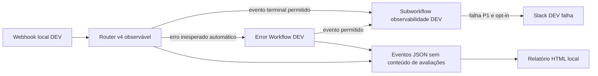

# Etapa 2 — Router DEV observável

## Estado e alcance

O usuário informou que avaliação nova, duplicata antes do LLM e falha segura do
precheck passaram no n8n local na candidata anterior. Isso não valida esta nova
integração: importação, pareamento, subworkflow, Error Trigger e Slack precisam
ser conferidos na versão **2.28.7** instalada. Nesta implementação houve somente
testes offline, sem engine n8n, APIs, ativação, deploy ou credenciais reais.

Nova candidata **inativa**, sem credenciais, dados fixados ou IDs locais de
workflow. V3, v4 original, v4 otimizada anterior e retenção foram preservados.
Os riscos/registros históricos da [retenção](etapa-2-observabilidade.md) continuam
válidos; sua aprovação anterior não é evidência de aprovação do Router integrado.

## Componentes separados



| Export | Papel |
| --- | --- |
| `vozdocliente-router-v4-observavel-dev.json` | Classificação, controles existentes, eventos por etapa, saídas de erro seguras |
| `vozdocliente-observabilidade-router-dev.json` | Execute Workflow Trigger, allowlist de evento, decisão e entrega do alerta |
| `vozdocliente-erros-router-dev.json` | Error Trigger, normalização mínima, entrega ao mesmo observador |

O gerador `scripts/build_router_observability.py` deriva do gerador da v4
otimizada. Reutiliza **diretamente** do gerador da retenção os parâmetros de
`Slack DEV falha`, `Alertar falha DEV?` e o código de `Resultado observabilidade`.
O transporte continua HTTP Request **4.1**, `sendBody: true` literal, JSON,
endpoint Slack fixo, sem redirect/retry, timeout de 5 s, confirmação HTTP 2xx **e**
`body.ok=true`. Não há cópia de token nem ligação à instância da porta 5680.
As credenciais dessa instância não aparecem automaticamente na porta 5678.

O contrato `n8n-mirror/observability/router-contract.json` define campos, etapas e
códigos permitidos. O JavaScript compartilhado é compilado nos Code nodes;
o relatório Python lê o mesmo contrato. Não há serviço de telemetria externo,
dependência de CDN, novo banco ou alteração no schema Airtable.

## Instrumentação e interrupções

`Recebimento observado DEV` gera `run_id=router-<execution.id>`, substituindo
qualquer `_obs` do cliente. Ele é correlacionável à execução **desta instância**,
não é um identificador de cliente nem global entre instâncias. As etapas são
`received`, `sanitization`, `precheck`, `llm`, `final_dedup`, `persistence` e
`business_slack`. Há eventos de início/conclusão e um terminal de tipo `run`:
`success`, `duplicate` ou `failure`.

`Sanitizar PII`, `Preparar deduplicacao DEV`, precheck, parser, consulta final e
bodies HTTP preservam seus parâmetros/código funcionais. LLM só recebe
`review_text_sanitized`; o texto original não é restaurado para classificá-lo.
O Airtable continua recebendo os campos originais para tratativa, como na v4.
Não há garantia de anonimização por regex.

Os dez nodes operacionais usam **`onError=continueErrorOutput`**, nunca
continuação pela saída normal. A segunda saída vai exclusivamente para
`Falha segura: <nome do node>`, que ignora o erro bruto, emite código fixo e
converge ao observador. `Falhou Router DEV?` envia falhas para
`Interromper com seguranca` (Stop And Error), com mensagem fixa. Falhar no
observador/Slack não libera LLM, criação ou reprocessamento.

Exemplos de códigos: `SANITIZATION_FAILED`, `DEV_CONFIG_INVALID`,
`PRECHECK_HTTP_FAILED`, `PRECHECK_INVALID`, `LLM_HTTP_FAILED`,
`CLASSIFICATION_INVALID`, `FINAL_DEDUP_HTTP_FAILED`, `PERSISTENCE_HTTP_FAILED`.
Não copiamos mensagem, URL do erro, stack, headers, corpo HTTP, review ID, texto,
nome, classificação individual ou canal aos eventos. O alerta contém apenas
run ID técnico, etapa, código, duração e número de tentativas.

### Error Workflow / Error Trigger

O mecanismo nativo dispara o Error Workflow associado quando uma execução
**automática** falha. **Executar manualmente/Test Webhook não dispara esse Error
Trigger**. Por isso HTTP precheck e os outros nodes operacionais têm captura
explícita de erro no próprio grafo, válida também no teste manual. Não usamos
Error Trigger como única proteção.

Na UI, selecionar `VozDoCliente - Erros Router DEV` em **Settings → Error
Workflow** da candidata. Essa associação exige um ID local e não está no export.
Error Workflow/subworkflow não precisam ser publicados para serem chamados;
conferir também a permissão de chamada entre workflows do mesmo projeto/owner.
Não configurar Error Workflow no observador nem nele próprio: evita recursão.

O normalizador aceita somente o ID explícito `ROUTER_OBSERVED_WORKFLOW_ID` e
`CLASSIFIER_ENV=DEV`. Usa `execution.id` original se disponível. Esse ID/URL pode
não estar disponível conforme persistência e fase da falha. Sem ID original,
usa `router-error-<ID da execução do handler>`, `correlation=error_handler`:
isso identifica **o incidente no handler**, não permite vincular com segurança
à avaliação/execução original. Contagens e duração desconhecidas ficam `null`.
Não habilitar armazenamento de payloads para tentar obter esse ID.

Uma parada cujo `lastNodeExecuted` seja `Interromper com seguranca` é ignorada
pelo Error Workflow, pois já teve evento terminal e tentativa de alerta. Não há
deduplicação durável de Slack: retries manuais ou um payload nativo diferente do
esperado podem repetir alertas. O relatório deduplica eventos/runs conhecidos,
mas não corrige entrega Slack duplicada.

Erros de preparação antes do primeiro node, perda do processo, crash, ausência
de logs, indisponibilidade do handler e certas interrupções/timeouts ainda podem
escapar. Erros inesperados dos próprios nodes de instrumentação em execução
manual não acionam Error Trigger. Não há watchdog ou garantia exactly-once.

Referências para conferência pelo responsável, **não consultadas por rede nesta
implementação**: [tratamento de erros n8n](https://docs.n8n.io/flow-logic/error-handling/)
e [Error Trigger](https://docs.n8n.io/integrations/builtin/core-nodes/n8n-nodes-base.errortrigger/).
O formato efetivo e essas integrações exigem a validação local descrita abaixo;
testes de VM não substituem teste do engine 2.28.7.

## Métricas e interpretação

Cada evento contém `schema`, `event_id`, `run_id`, `correlation`, `at`, `source`,
`kind`, `stage`, `status`, `duration_ms`, `error_code` e `metrics`. Contadores de
runs valem 1 somente no terminal. Inícios/conclusões não multiplicam volume.

| Medida | Definição e limite |
| --- | --- |
| Volume | Runs distintos observados/terminais, recebimentos conhecidos, incompletos e incidentes correlacionados só ao handler separados. Não inferir tráfego dos incidentes sem ID original. |
| Sucesso/duplicata/falha | Estados terminais separados; taxa de erro = falhas / terminais na janela fornecida. Incompletos não entram nesse denominador e aparecem separadamente. Não é disponibilidade/SLO. |
| Latência p50/p95/p99 | Nearest-rank: posição `ceil(p*N)`. Só durações conhecidas. Total do processamento até o evento terminal, inclui instrumentação e Slack CX quando executado; exclui entrega do alerta/observador posterior. Etapas concluídas têm percentis próprios. Não é latência HTTP do webhook, que responde no início. |
| LLM | `llm_calls_attempted` marca entrada na chamada, sem retry; não comprova transporte aceito ou faturamento. `llm_responses` conta respostas recebidas, inclusive JSON inválido. Falha antes de enviar ainda pode contar uma tentativa. |
| Persistência | Escritas confirmadas. Timeout pode ocorrer depois da criação no Airtable; zero confirmações não prova ausência de gravação. A corrida após a deduplicação final continua existindo. |
| Custo estimado LLM | `(prompt_tokens*preco_entrada + completion_tokens*preco_saida)/1e6`. Tokens vêm de `usage`, sem conteúdo. Sem uso/preço válido fica `null`; sem tentativa é zero. Relatório mostra subtotal conhecido e cobertura, nunca converte desconhecido em fatura zero. Exclui cache/descontos, Airtable, Slack e infraestrutura. |
| Qualidade técnica | `classification_valid / llm_responses` conhecidas: aderência aos enums/JSON após parser. Não é acurácia de sentimento/tema. `classification_accuracy=null`, `human_labels=0` até haver corpus rotulado e avaliação humana independente. |

Preços em USD/milhão não têm default e devem ser confirmados para o modelo/projeto,
com data/fonte registradas pelo responsável. Não houve consulta de preço/modelo.
O modelo/prompt/schema foram preservados; a equivalência sintética de 120 entradas
compara todos os registros com a candidata anterior. Não mede qualidade humana.
O custo/latência extra da instrumentação e do subworkflow requer medição DEV;
nenhum ganho de desempenho foi alegado.

## Slack operacional e configuração

Falha terminal = **P1 demonstrativo** para o responsável DEV; sucesso/duplicata
não geram alerta. Não é SLA de produção. Falha de entrega da observabilidade é
um incidente **P2** para investigação local, sem alerta recursivo. Alertas CX
por sentimento negativo continuam no node separado `Slack DEV` e não são falhas.

Em `n8n-mirror/.env`, usado explicitamente nos comandos abaixo:

```dotenv
CLASSIFIER_ENV=DEV
# Manter IDs DEV da base/tabela/canal ja validados, nunca PROD.
ROUTER_OBSERVER_WORKFLOW_ID=<ID local de VozDoCliente - Observabilidade Router DEV>
ROUTER_OBSERVED_WORKFLOW_ID=<ID local da nova candidata Router>
ROUTER_ALERTS_ENABLED=false
ROUTER_OBS_STDOUT_ENABLED=false
OBS_LLM_INPUT_USD_PER_MILLION=
OBS_LLM_OUTPUT_USD_PER_MILLION=
```

IDs não são credenciais, mas exigem conferência manual do destino: não apontar
o observador para qualquer outro workflow, especialmente Router/handler ou PROD.
Definir `ROUTER_ALERTS_ENABLED=true` somente para receber alerta **real** no canal
`CLASSIFIER_SLACK_DEV_CHANNEL_ID` já validado. Selecionar Header Auth Slack DEV
no node **`Slack DEV falha` do subworkflow**. Verificar bot/canal/workspace e
escopo `chat:write`, sem abrir tokens em evidências. A credencial de `Slack DEV`
na candidata é independente desta seleção.

`CODE_ENABLE_STDOUT` é global e só é habilitado quando
`ROUTER_OBS_STDOUT_ENABLED=true`. Revisar os demais workflows locais antes disso:
eles podem imprimir PII. Manual envia console ao navegador; chamadas/subworkflows
não manuais podem enviar ao stdout. O Compose prevê rotação por tamanho (5 MiB,
3 arquivos), **não por idade**. Nenhum contêiner foi recriado nesta entrega.

Após importar e anotar IDs, aplicar somente à instância local (raiz do projeto;
reutilizar o mesmo `-p` se a instância tiver projeto customizado):

```powershell
docker compose --env-file n8n-mirror/.env -f n8n-mirror/docker-compose.yml config --quiet
docker compose --env-file n8n-mirror/.env -f n8n-mirror/docker-compose.yml up -d --no-deps --force-recreate --pull never n8n
```

O observador ausente/inacessível produz `not_configured`/`delivery_failed` e evento
`OBS_DELIVERY_FAILED`; não apaga o terminal nem modifica classificação/dedup.
Entrega Slack distingue `not_needed`, `disabled`, `blocked`, `sent`, `failed`.
Timeout pode ocorrer após entrega; não há retry automático.

## Relatório local e evidência reproduzível

Sem n8n/credenciais/APIs, na raiz:

```powershell
python scripts/build_router_observability.py --check
node tests/test_router_observability.cjs
node scripts/simular_router_observabilidade.cjs --output docs/evidencias/router-observabilidade-simulacao.ndjson --metadata-output docs/evidencias/router-observabilidade-simulacao.json
python scripts/router_observability_report.py --input docs/evidencias/router-observabilidade-simulacao.ndjson --output docs/evidencias/router-observabilidade-simulacao.html
```

Abrir [relatório visual](evidencias/router-observabilidade-simulacao.html).
[Eventos](evidencias/router-observabilidade-simulacao.ndjson) e
[manifesto com hashes](evidencias/router-observabilidade-simulacao.json) registram
**3 execuções simuladas: 1 sucesso, 1 duplicata, 1 falha de precheck; 1 chamada LLM
simulada e 1 alerta simulado; zero chamadas externas**. Tokens da resposta são
fixtures sintéticas. Tempos vêm de `Date.now()` no harness local, com mocks
imediatos, sem atraso artificial; não são latências de n8n/Airtable/OpenAI.
Percentis variam ao reproduzir. A amostra pequena não demonstra p99 operacional.
Na evidência anexada: **23 eventos**, taxa de falha do cenário **1/3**, p50
**5 ms**, p95 **31 ms** e p99 **31 ms**, com N=3 no harness local. Esses números
descrevem apenas a simulação coletada, não a instância n8n nem os fornecedores.
Preço não configurado deixa o custo da classificação desconhecido; validade
técnica da única resposta sintética não demonstra acurácia real.

Para eventos **realmente coletados** no n8n, copiar só as linhas JSON com `schema`
do console (ou stdout, após opt-in) para um arquivo local `router-local.ndjson`.
Não exportar a execução inteira. Gerar relatório em destino local fora do Git:

```powershell
python scripts/router_observability_report.py --input router-local.ndjson --output router-local.html --events-output router-local-permitido.ndjson
```

O leitor aceita JSONL e prefixo de stdout/Docker; rejeita campos extras, códigos,
tipos e números inválidos. Não retransmite nem grava linhas rejeitadas. O HTML
não contém scripts remotos/credenciais. `source=n8n` e `offline_simulation` são
agregados em painéis separados; origem é uma marca de coleta, não assinatura de
autenticidade. Não misturar logs de várias instâncias com IDs possivelmente iguais.
Falhas prevalecem em terminais conflitantes do mesmo run; evento inline é
preferido ao fallback do handler. Isso não reconstrói dados perdidos.

## Validação manual indispensável — n8n 2.28.7 / porta 5678

1. Importar **os três exports como novos workflows**, inativos. Selecionar
   credenciais DEV nos nodes operacionais e no `Slack DEV falha` do observador.
   Conferir base, tabela completa de classificação, canal e modelo já usados no
   teste anterior. Anotar os dois IDs no `.env`, aplicar o Compose pelo responsável
   e configurar Error Workflow na UI. Restringir chamada do observador ao Router
   e ao handler no projeto/owner local. Não alterar Railway/v3/v4.
2. Em `Webhook Review`, escutar um POST de teste para
   `http://localhost:5678/webhook-test/review-v4-observavel-dev`. Reusar uma fixture
   **sintética** válida com ID novo. Em `Resultado Router DEV`, esperar
   `report.status=success`, `llm_calls_attempted=1`, `persisted=1`; conferir todas
   as etapas e que o prompt só contém o texto de `Sanitizar PII`.
3. Repetir a mesma fixture/ID em nova escuta: `duplicate`, tentativas 0,
   persistência 0, nenhum `LLM DEV` executado nessa execução. Recolher eventos.
4. Em cópia isolada da candidata na UI, apontar **só o GET de `Airtable Precheck
   DEV`** a um ID de tabela sintético confirmado inexistente, dentro da base DEV
   e domínio Airtable originais. Fazer um único POST sintético. Esperar erro na
   segunda saída → `Falha segura: Airtable Precheck DEV` → observador →
   `Interromper com seguranca`. Código `PRECHECK_HTTP_FAILED`, zero LLM/criação;
   com opt-in, `alert_status=sent` e mensagem `[DEV][P1]` com o mesmo run ID no
   Slack. Esta ação manual faz GET DEV e, se habilitado, Slack real. Descartar a
   cópia. Não há DELETE. Capturar somente evento/métricas, sem erro bruto.
5. **Validar o mecanismo nativo separadamente:** na candidata local com ID
   configurado, substituir temporariamente na UI o código de
   `Sanitizacao observada DEV` por `throw new Error('Falha sintetica controlada.');`.
   Publicar temporariamente **somente essa candidata DEV local**; enviar uma
   única fixture à URL automática local
   `http://localhost:5678/webhook/review-v4-observavel-dev`. A falha ocorre após
   sanitizar, antes de qualquer Airtable/LLM. Esperar execução automática de
   `Erro Router DEV`, `WORKFLOW_INTERRUPTED`, métricas desconhecidas `null` e
   alerta DEV se habilitado. Conferir `correlation`: ID original quando fornecido,
   ou ID do handler com limitação explícita. Despublicar e restaurar pelo export;
   restaurar a associação/credenciais locais se necessário. O nome técnico
   "production URL" do n8n aqui significa `/webhook` **em localhost**, não PROD.
   Esse mesmo throw em execução manual não chama Error Trigger — resultado esperado.
6. Em execução **automática** de falha operacional já capturada, conferir que
   `Interromper com seguranca` não causa um segundo alerta no Error Workflow.
   Confirmar o campo `lastNodeExecuted` efetivo; se divergir, não considerar
   deduplicação de alerta validada. Não usar execução manual como prova disso.
7. Gerar o relatório com os JSONs reais recolhidos. Capturar versão do n8n,
   canvas/saída permitida dos três cenários, run ID, percentis e N, cobertura de
   custo, acurácia pendente e mensagem Slack. Identificar quem validou e data.
   Não apresentar a simulação entregue como execução real.

Todos os passos com APIs/ativação são **ações manuais posteriores**, não foram
executados pelo agente. A ligação entre workflows, compatibilidade dos nodes
Execute Workflow v1/Error Trigger v1/Stop And Error v1 e comportamento nativo de
erro/console só ficam validados depois desses passos no engine instalado.

## Privacidade, acesso e retenção remanescentes

Logs novos são mínimos, mas correlacionáveis, não anonimizados. Payload original,
erros HTTP nativos e entrada original de Error Trigger podem existir
transitoriamente no engine/browser. Os três exports mantêm salvamento de payloads
de sucesso/erro/manual/progresso desabilitado; não flexibilizar para evidências.
Isso não garante que logs internos, históricos anteriores, backups ou Slack
estejam limpos. Revisar mensagens da plataforma e controle de acesso separadamente.

Retenção do Airtable continua no componente próprio; não foi ampliada para
auditoria de telemetria. Docker roda por tamanho, browser/arquivos locais/Slack
precisam de prazo, acesso e descarte definidos pelo responsável. Revisar eventos
antes de versionar evidências reais. Arquivos `router-local*` não devem ser
commitados. Não existe alegação de conformidade integral com a LGPD.

## Arquivos desta integração

Arquivos existentes alterados nesta implementação (o workspace já continha
alterações de etapas anteriores):

- `.env.example`, `n8n-mirror/docker-compose.yml`: configuração local opt-in, IDs,
  preços, stdout e rotação por tamanho; nenhum `.env` real alterado.
- `.gitignore`: exclui arquivos de coleta `router-local*` da raiz.
- `.github/workflows/ci.yml`, `tests/validate_workflows.py`: checks offline novos.
- `README.md`, `CHANGELOG.md`, `n8n-mirror/README.md`,
  `docs/etapa-2-observabilidade.md`, `docs/lgpd/checklist-etapa-2.md`: referências,
  escopo, pendências e roteiro.

Novos arquivos:

- `.gitattributes`: LF somente nos novos exports/evidências, para preservar hashes em clones Windows.
- `n8n-mirror/observability/router-contract.json`
- `n8n-mirror/observability/router-common.js`
- `n8n-mirror/observability/router-alert.js`
- `n8n-mirror/observability/router-error.js`
- `n8n-mirror/observability/router-result.js`
- `n8n-mirror/workflows/vozdocliente-router-v4-observavel-dev.json`
- `n8n-mirror/workflows/vozdocliente-observabilidade-router-dev.json`
- `n8n-mirror/workflows/vozdocliente-erros-router-dev.json`
- `scripts/build_router_observability.py`
- `scripts/router_observability_validation.py`
- `scripts/router_observability_report.py`
- `scripts/simular_router_observabilidade.cjs`
- `tests/router_observability_harness.cjs`
- `tests/test_router_observability.cjs`
- `tests/test_router_observability.py`
- `docs/etapa-2-observabilidade-router.md`
- `docs/evidencias/router-observabilidade-simulacao.ndjson`
- `docs/evidencias/router-observabilidade-simulacao.json`
- `docs/evidencias/router-observabilidade-simulacao.html`
